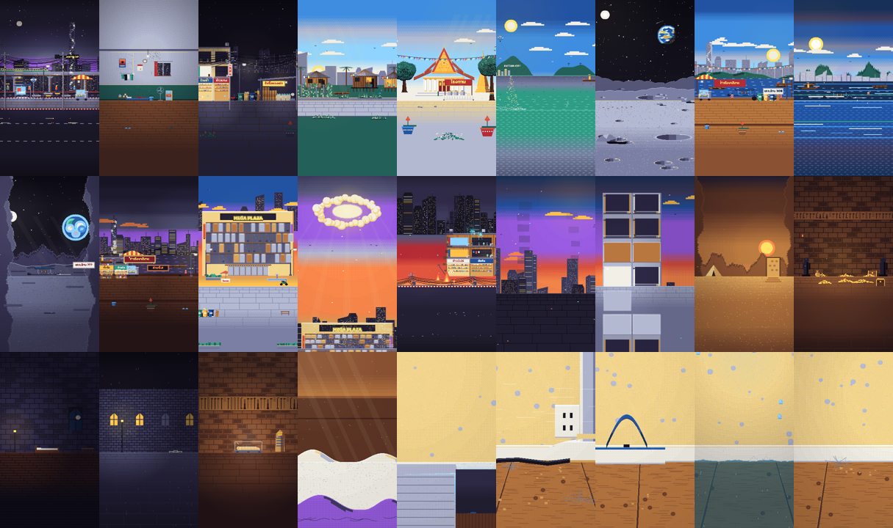

# Legend Studio — คลังงานภาพ (ใช้ซ้ำได้)

คลังงานภาพพิกเซลอาร์ตของช่อง **ตำนานติดบั๊ก** ที่ทำกับแอป Legend Shorts Studio
เก็บไว้เพื่อหยิบไปใช้ในคลิปใหม่ และสร้างทุกอย่างใหม่ได้จากโค้ดในนี้



## มีอะไรบ้าง

| โฟลเดอร์ | คืออะไร |
|---|---|
| `library/scenes/` | ฉาก 27 ฉาก (สเปกฉาก JSON) — ชุดเดียวกับ "คลังฉาก" ในแอป |
| `library/previews/` | ภาพตัวอย่างของแต่ละฉาก (270×480) |
| `library/pixel/<โปรเจกต์>/` | ของ สัตว์ และของตกแต่งตัวละครแบบพิกเซล (`{pal, rows}` หรือ `{idle, action}` สำหรับสัตว์) |
| `library/characters/<โปรเจกต์>.json` | สูตรตัวละคร LPC (ชั้นภาพ สี ปีก หมวก รัศมี) |
| `projects/<โปรเจกต์>/` | บท จังหวะ การ์ดทั้งหมด (`*.src.js`) แผนที่พิกเซล บทพากย์ และเวลาคำ |
| `studio/` | โค้ดแอปและเอนจิน (`src/`), เครื่องมือวาด (`tools/mk*.mjs`), เสียงประกอบ (`assets/sfx/`), ภาพ LPC (`dist/lpc/`) |

โปรเจกต์: `b100` = 100 บาท 7 วัน · `tiny` = ตัวหดเหลือ 2 เซน · `wings` = ทั้งเมืองมีปีก · `moonboat` = สปีดโบ๊ทวาร์ปไปดวงจันทร์

## เอาไปใช้ซ้ำ

- **ฉาก**: ในแอปขั้น 3 กด "+ ฉากจากคลัง" หรือคัดลอก `spec` จาก `library/scenes/*.json` ไปใส่การ์ดฉาก
- **ของ/สัตว์**: ใส่ `map` (หรือ `frames`) จาก `library/pixel/` ลงการ์ดของ/สัตว์
- **ตัวละคร**: ใส่ `recipe` จาก `library/characters/` ลงการ์ดตัวละคร
- ฉากหลายฉากใช้ชิ้นส่วนที่เขียนไว้ในเอนจิน (`studio/src/engine/scene_*.js`) จึงต้องใช้เอนจินเวอร์ชันในนี้ขึ้นไป

## สร้างใหม่

```sh
cd studio && python3 tools/build.py            # dist/index.html (แอป) + dist/engine.js
node tools/mktiny.mjs ../projects/tiny/maps.json   # วาดของในคลิปตัวหดใหม่ (มี mkwings / mkboat / mkmaps ด้วย)
python3 -m http.server 8766 & node qa/previews.mjs http://localhost:8766   # (รันที่รากรีโป) ทำภาพตัวอย่างฉากใหม่
```

## เครดิตและสัญญาอนุญาต

ภาพตัวละครมาจาก [Universal LPC Spritesheet Character Generator](https://github.com/LiberatedPixelCup/Universal-LPC-Spritesheet-Character-Generator)
ใช้ภายใต้ OGA-BY 3.0 / CC-BY-SA 3.0 / GPL 3.0 / GPL 2.0 / CC-BY 3.0 / CC0 — รายชื่อผู้วาดแต่ละชิ้นอยู่ใน `studio/dist/lpc/catalog.json` (`credits`)
ต้องใส่เครดิตนี้ในคำอธิบายคลิปทุกครั้ง (แอปใส่ให้อัตโนมัติ)
เสียงประกอบใน `studio/assets/sfx/` สร้างด้วย ElevenLabs
ฉาก ของ และสัตว์ที่วาดเองในคลังนี้เป็นงานของช่อง
